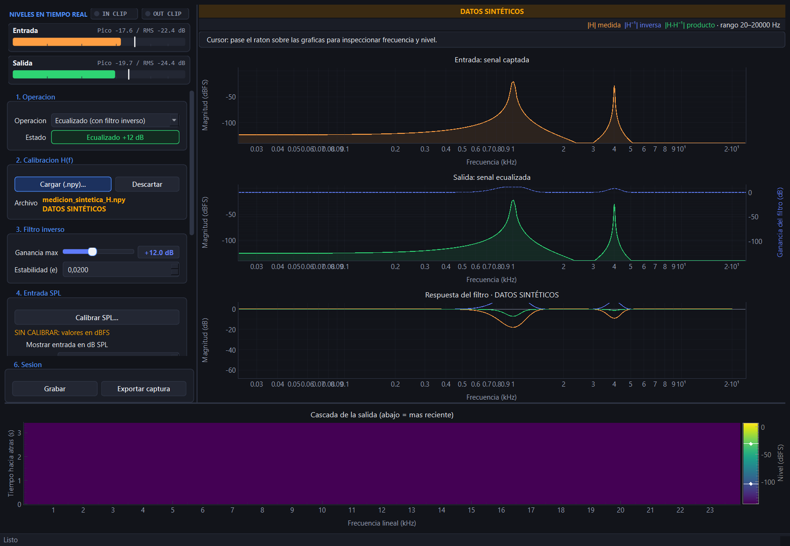

# Filtro inverso con interfaz en tiempo real

Ecualizador FFT full-duplex en tiempo real: mide la respuesta de un circuito,
calcula su filtro inverso regularizado y lo aplica mientras se ven los
espectros de entrada y salida en vivo.

## Inicio rápido

Desde esta carpeta, cree y active un entorno virtual e instale las dependencias:

```powershell
py -m venv .venv
.\.venv\Scripts\Activate.ps1
py -m pip install -r requirements.txt
```

Como alternativa, puede instalar el proyecto editable con sus herramientas de
prueba: `py -m pip install -e ".[test]"`.

Abra la interfaz de espectros y ecualización en tiempo real:

```powershell
py main.py
```

Sin argumentos se abre en modo *bypass*: sirve para comprobar el micrófono, los altavoces y las gráficas sin usar una corrección medida. Use auriculares o volumen bajo para evitar realimentación acústica.

### Accesos directos

`crear_accesos.ps1` genera tres accesos en el escritorio:

| Acceso | Qué abre |
|---|---|
| `Filtro Inverso.lnk` | La interfaz gráfica, sin ventana de consola. |
| `Filtro Inverso (Consola).lnk` | La misma interfaz conservando la consola para ver errores. |
| `Calibrar Filtro Inverso.lnk` | La calibración del circuito. |

```powershell
powershell -ExecutionPolicy Bypass -File .\crear_accesos.ps1
```

## La interfaz

Captura reproducible con señales sintéticas y sin hardware:



- **Panel de control** (izquierda): modo *bypass* / *ecualizado*, carga de la
  medición `.npy`, ganancia máxima, estabilidad (ε), interfaz de audio,
  frecuencia de muestreo y tamaño de FFT.
- **Medidores de nivel**: pico y RMS de entrada y salida. Los indicadores
  `IN CLIP` y `OUT CLIP` se retienen por separado cuando cada señal alcanza
  0,999 de escala lineal. Un limitador suave protege la salida.
- **Espectros**: entrada (naranja) y salida (verde), más la curva del filtro
  inverso aplicado (azul discontinuo). La gráfica inferior muestra por defecto
  la respuesta medida, la inversa y su producto; se puede alternar a una
  comparación entrada/salida. Sin calibración válida aparece «Sin calibración
  cargada» en vez de curvas de respuesta ficticias. Los ejes de frecuencia de
  los espectros usan kHz; pase el ratón para leer Hz y niveles.
- **Cascada**: historial lineal en kHz del espectro de salida en dBFS; el
  tiempo avanza hacia abajo y la escala de color se fija entre −140 y +6 dBFS.

Cambiar la interfaz, el muestreo o el tamaño de FFT reinicia el stream de audio.
La calibración se descarta si deja de ser compatible con el nuevo tamaño de FFT
o con la nueva frecuencia de muestreo.

### Elegir la interfaz de audio (Windows)

En Windows la entrada y la salida de una misma interfaz (por ejemplo el ESP32-S3
como tarjeta de sonido USB) aparecen como dos dispositivos separados. La lista
«Interfaz» los ofrece ya emparejados por nombre, primero WASAPI y luego MME.
Para ver qué detecta el programa en su equipo:

```powershell
py -m src.audio.devices
```

Desde la línea de comandos también se pueden indicar a mano:

```powershell
py main.py --input-device 9 --output-device 8
```

La salida está limitada suavemente a 0,98 de la plena escala para no recortar
con ganancias altas del filtro; el medidor CLIP sigue avisando cuando el filtro
pide más.

## Calibración

Para generar una respuesta medida, conecte el circuito, mantenga un volumen seguro y ejecute:

```powershell
py calibrate_hardware.py
```

El calibrador reproduce cuatro barridos por defecto, promedia la respuesta y
guarda `medicion_H.npy` y la coherencia cuadrática `medicion_gamma2.npy`. Ajuste
el número de capturas con `--sweeps`; se requieren al menos dos. Después inicie
la interfaz con los archivos producidos:

```powershell
py main.py --h-response medicion_H.npy --coherence medicion_gamma2.npy
```

Para guardar también una respuesta impulsional diagnóstica mediante
deconvolución Farina, añada `--farina-output medicion_ir.npy`. Este archivo no
se usa para construir el filtro inverso.

También puede cargar la medición desde el botón *Cargar medicion (.npy)...* del
panel de control, sin reiniciar el programa.

Para probar la interfaz sin circuito, `generar_medicion_demo.py` sintetiza una
medición con muescas en 1 kHz y 4 kHz. Los archivos llevan `medicion_sintetica`
en el nombre y un sidecar JSON que identifica la procedencia. Acepte el formato
predeterminado o especifique el mismo tamaño FFT y frecuencia de muestreo que
usará en la interfaz:

```powershell
py generar_medicion_demo.py --fft-size 4096 --sample-rate 96000
py main.py --fft-size 4096 --sample-rate 96000 --h-response medicion_sintetica_H.npy --coherence medicion_sintetica_gamma2.npy
```

El sidecar de calibración debe incluir versión del formato, frecuencia de
muestreo, tamaño FFT, rango válido en Hz y la marca `synthetic`. La aplicación
rechaza calibraciones sin esos metadatos o incompatibles con el formato actual.
Los gráficos y exportaciones indican si los datos son sintéticos o no sintéticos;
no se debe interpretar una demo como una medición física.

## Calibración dB SPL

La escala de entrada se convierte mediante **dB SPL = dBFS + offset**. El offset
depende de la cadena de captura; sin un offset válido, la interfaz indica
`SIN CALIBRAR` y todos los valores de entrada permanecen en dBFS.

### Asistente de calibración

Con la entrada que desea calibrar seleccionada, abra el asistente desde el panel
**Entrada SPL**. El diálogo (`QDialog`) toma las muestras de esa entrada y guía
tres pasos:

1. **Preparación:** use un calibrador de **94 dB SPL a 1 kHz** acoplado al
   micrófono. Como alternativa, mida la misma señal con un sonómetro y use su
   lectura como referencia SPL; el valor de referencia es ajustable.
2. **Medición:** mantenga estable la referencia y capture **1 s** de entrada. La
   medición solo es válida si cumple simultáneamente:
   - RMS > -70 dBFS.
   - Pico < -1 dBFS.
   - Variación de RMS < 1 dB.
3. **Resultado:** compruebe y aplique el offset calculado como
   `offset_db = referencia SPL - RMS dBFS`.

Al aplicar una medición válida se guarda `calibracion_spl.json` en la raíz del
proyecto. Contiene `offset_db`, `date` (fecha ISO en UTC) y `device_name`, y está
ignorado por git. La calibración se carga al iniciar el programa; si la entrada
actual no coincide con `device_name`, la aplicación avisa que debe recalibrar.

También puede indicar un offset conocido desde la línea de comandos:

```powershell
py main.py --spl-offset 120
```

`--spl-offset VALOR` tiene prioridad sobre el archivo. Si cambia de micrófono o
interfaz de entrada, repita el asistente con esa entrada y una referencia válida,
o proporcione su offset con `--spl-offset`; no reutilice el valor anterior sin
comprobarlo.

### Ponderación, zonas y unidades

- **Z:** nivel total sin ponderación de frecuencia.
- **A:** nivel total con ponderación A.
- **C:** nivel total con ponderación C, de menor atenuación en graves que A.

Z/A/C se aplica al **nivel total**. La curva FFT de entrada solo recibe el offset
cuando se muestra en dB SPL; no se le aplica la ponderación. La salida, el
espectrograma, los medidores de pico/RMS y la indicación `CLIP` permanecen
siempre en dBFS.

Con ponderación A, el nivel total usa estas zonas de color: **verde** por debajo
de 70 dB SPL, **amarillo** entre 70 y 85 dB SPL, ambos incluidos, y **rojo** por
encima de 85 dB SPL. Como contexto aproximado:

| Sonido | Nivel orientativo |
|---|---:|
| Susurro | ~30 dB SPL |
| Conversación | ~60 dB SPL |
| Calle | ~80 dB SPL |
| Grito | ~90 dB SPL o más |

La precisión de las lecturas depende de la referencia utilizada, la ganancia y el
dispositivo de entrada. Una calibración solo es representativa de la cadena con
la que se midió.

## Convenciones DSP y latencia

Los niveles espectrales usan dBFS de pico (amplitud lineal 1 equivale a 0 dBFS),
con un piso de visualización de −140 dBFS. El nivel RMS total de un seno a escala
completa es aproximadamente −3,01 dBFS. La convolución WOLA es causal y añade
un hop de latencia algorítmica (por ejemplo, 21,3 ms con FFT 2048 a 48 kHz);
esto no incluye los buffers de entrada/salida del dispositivo, que dependen del
hardware y no se verifican en las pruebas sintéticas.

El parámetro ε es adimensional y regulariza respecto de la potencia de
referencia de la respuesta, proporcional a `|H(f)|²`; aumentarlo suaviza la
inversión. La ganancia máxima se expresa en dB.

## Pruebas automatizadas

```powershell
py -m pytest -q
```

## Análisis numérico

Ejecute el análisis de la medición demo para comparar la solución analítica con
el descenso de gradiente y obtener condición, retardo de grupo, energía y corte:

```powershell
py analisis_numerico.py
```

Para evaluar linealidad, mida el circuito a dos amplitudes distintas y guarde
las respuestas en carpetas separadas:

```powershell
py calibrate_hardware.py --amplitude 0.05 --output .\medicion_baja\medicion_H.npy
py calibrate_hardware.py --amplitude 0.15 --output .\medicion_alta\medicion_H.npy
py analisis_numerico.py --linearity-low .\medicion_baja\medicion_H.npy --linearity-high .\medicion_alta\medicion_H.npy
```

Para analizar una medición concreta, use `--h-response`, `--coherence`,
`--sample-rate` y `--fft-size` con el mismo formato de captura.

## Estructura del proyecto

```
main.py                       Punto de entrada: argumentos de línea de comandos.
calibrate_hardware.py         Medición por barrido logarítmico (log sine sweep).
generar_medicion_demo.py      Medición sintética para probar la interfaz.
crear_accesos.ps1             Genera los accesos directos del escritorio.
src/audio/engine.py           Stream full-duplex, ecualizador y calibración.
src/config.py                 Constantes DSP, formato, frecuencia y visualización.
src/dsp/inverse_filter.py     Filtro inverso Wiener/Tikhonov y procesador WOLA.
src/dsp/numerics.py           Métodos numéricos y métricas académicas.
analisis_numerico.py          Comparación analítica/gradiente y linealidad.
src/dsp/spectrum.py           Espectro, niveles, ponderación Z/A y conversión dBFS/dB SPL.
src/ui/calibration.py         Asistente QDialog de calibración SPL en tres pasos.
src/ui/window.py              Ventana principal e integración de la calibración SPL.
src/ui/controls.py            Panel de control y acciones SPL.
src/ui/meters.py              Medidores de nivel e indicador de saturación.
src/ui/spectrogram.py         Cascada temporal.
src/ui/readout.py             Lectura de valores bajo el cursor en dBFS/dB SPL.
src/ui/spl_context.py         Contexto físico y zonas de color para niveles SPL.
src/ui/spl_persistence.py     Persistencia JSON y detección de la entrada calibrada.
src/ui/theme.py               Paleta de la interfaz.
tests/test_spl.py             Conversión, ponderación y presentación de niveles SPL.
tests/test_spl_calibration_dialog.py  Flujo y validaciones del asistente SPL.
tests/test_spl_context.py     Contexto físico y límites de las zonas de color.
tests/test_spl_persistence.py Persistencia, carga inicial y prioridad del offset CLI.
```
